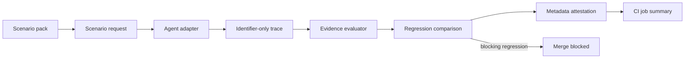

# Building the Agent Assurance Harness

This document explains the engineering judgment behind the Agent Assurance Harness.
`GUIDE.md` explains how to operate and review the repository; this file explains how to
extend it without weakening the assurance boundary.

The project exists because a green test can still be misleading. An agent may use the
wrong tool, skip a required check, answer without usable evidence, retry a protected write
unsafely, or pass an evaluator that never checked the important condition. The harness
turns those failure modes into small, observable, repeatable contracts.

## The design thesis

The harness does not attempt to produce one universal “agent quality” score. It asks a
narrower question:

> For this declared task, what observable evidence must exist before the agent may claim
> success, answer, or perform a protected side effect?

That choice is deliberate. A single score can hide the difference between a correct task
outcome, complete evidence, safe abstention, and authorized action. These properties are
reported as separate assurance dimensions so a reviewer can see which property changed.

The harness is intentionally synthetic and provider-neutral by default. It demonstrates
the control without requiring credentials, private data, network access, or raw provider
output.

## Architecture



The important boundary is the trace. It carries tool names, statuses, synthetic
identifiers, source identifiers, numeric evidence age, authorization references, and
outcome classifications. It does not carry prompts, hidden reasoning, raw arguments,
record contents, credentials, or provider text.

This is not a claim that identifiers are magically safe. It is a deliberately narrow
public-repository contract: only fields that the evaluator needs may cross the boundary.
Anything else is refused or omitted.

## Failure model

Each built-in scenario has four parts:

1. A named failure mode that could make a result appear acceptable.
2. An evidence contract that states what must be observable.
3. A naive path that demonstrates the failure.
4. A guarded path and evaluator test that demonstrate the expected control.

The current progression is intentionally operational:

| Phase | Failure or control | What it makes visible |
|---|---|---|
| 1 | Evidence contracts and synthetic failure cases | Which facts are required before a result passes |
| 2 | Ambiguous timeout, retry identity, and reconciliation | Why a retry response is not proof of one committed write |
| 3 | Authorization binding and action digests | Whether approval belongs to this operation and action |
| 4 | Execution budgets | Whether request, token, time, and spend ceilings were enforced |
| 5 | Pull-request assurance summaries | Whether reviewers can see the decision and provenance in CI |
| 6 | Evidence source and freshness | Whether evidence is from the approved source and within its age window |
| 7 | Golden Trace baseline | Whether canonical successful evidence drifted even when status still passes |
| 8 | Operational ship gate | Who notices a failure, what blocks release, how to roll back, and what audit record remains |
| 9 | Audit evidence binding | Whether the release record is complete and matches the current checkout and approved baseline |

The phases are not claims that these are the only production failures. They are a growing
set of concrete controls with explicit limits.

## What counts as evidence

An `EvidenceContract` is the machine-readable contract for one scenario. Each requirement
uses a fixed identifier prefix, such as `tool:`, `successful_tool:`, `authorization:`,
`side-effect:`, `output:`, or `abstain:`.

The prefix is a protocol boundary, not decoration. It lets the declarative pack evaluator
remain limited to known checks instead of executing arbitrary predicates supplied by a
pack.

Successful tool-result requirements may also declare:

- `source`: the approved source identifier; and
- `max_age_seconds`: the maximum permitted age of that evidence.

Both values are metadata, not record content. The evaluator rejects a result when the
source is wrong, the age is missing, or the age exceeds the declared limit. This catches
“right answer from stale cache” failures without exporting the record that was retrieved.

## How to add a control

Add one complete vertical path, in dependency order:

1. **Name the failure.** State what can go wrong and what a reviewer would observe first.
2. **Write the contract.** Define the minimum evidence and the strongest claim it does not
   establish.
3. **Add the synthetic environment.** Return identifiers and classifications only.
4. **Add naive and guarded traces.** The naive trace must fail for the intended reason; the
   guarded trace must pass for the intended reason.
5. **Add a mutation.** Remove, replace, stale, or misbind the evidence and prove the
   evaluator catches it.
6. **Propagate the fields.** Update the recorder, subprocess protocol, provider-shaped
   adapters, OTLP importer, MCP schema, replay fixture, and report if the new evidence
   crosses those boundaries.
7. **Test the privacy boundary.** Include a test showing that raw content or an unknown
   field is refused without being echoed.
8. **Update operator documentation.** Explain how to read the result, what it proves, and
   what it does not prove.
9. **Run the delivery checks.** The relevant path must pass unit, integration, boundary,
   dependency, lock, and release checks before it is considered complete.

This order matters. Adding a field only to the evaluator creates a local demo that can
disappear at the first serialization boundary.

### Golden Trace rule

The Golden Trace is a baseline for canonical observable evidence, not a snapshot of
prompts or model internals. Its digest includes tool-result identifiers and statuses,
source and age metadata, authorization and retry identity, abstention, and other fields
the evaluator uses. It excludes free-form claim and answer wording so a harmless wording
change does not become a false safety alarm.

The checked-in baseline is refreshed only after review because refreshing it can turn an
unreviewed behavior change into the new expected behavior. The manifest is tied to the
current scenario-pack set, so a pack change cannot silently reuse an old baseline.

## Decision record format

For any decision a competent engineer could reasonably make another way, record:

```text
Decided: <the choice>
Instead of: <the credible alternative>
Why: <the consequence that made this choice better>
Costs if wrong: <what becomes harder or unsafe>
Decided by: <person or review authority>
```

The alternative is required. Without it, a later reviewer cannot tell whether the design
was deliberate or simply the first implementation that worked.

Examples from this build:

- Keep the public harness synthetic and metadata-only instead of adding live credentials
  or a hosted service, because the repository must demonstrate the control without
  publishing protected material. The cost is that live-model behavior remains untested.
- Extend `successful_tool:` with source and age instead of adding a new requirement
  prefix, because the existing protocol already describes successful evidence. The cost
  is that the requirement has a more detailed shape.
- Accept legacy version-2 custom packs instead of forcing an immediate migration, because
  older synthetic packs do not need the new optional metadata. The cost is that source and
  freshness checks require the current pack schema.

## Privacy and security boundary

The public repository must remain synthetic-only. Never add:

- credentials or credential values;
- environment dumps;
- prompts or hidden reasoning;
- customer, candidate, exam, or internal content;
- raw provider requests or responses;
- raw tool arguments or results;
- unrestricted file or network access to the MCP server; or
- a claim that metadata is a signed provenance statement when it is not.

The MCP server is read-only. The external adapter boundary uses an argument vector rather
than a shell, limits response and diagnostic output, and applies timeout and best-effort
resource ceilings. These controls reduce accidental exposure and runaway execution; they
are not a complete sandbox for hostile code.

The live provider path is intentionally separate from the default CI path. Provider
credentials are referenced by environment-variable name, not stored or logged. Adding a
real provider requires a new review of credential handling, request limits, spend limits,
privacy, network access, and rollback.

## CI and production path

The CI workflow is a pre-merge assurance gate: a repeatable check that runs before a
change is accepted into the main branch. It:

- compares a baseline adapter with a candidate adapter;
- blocks safety and evidence regressions;
- runs a deliberately degraded negative control;
- verifies the Git revision and scenario-pack fingerprints;
- renders metadata-only evidence in the GitHub Actions job summary; and
- proves that credentials, prompts, traces, and provider output are not exported.

The next production integration is not “turn on a model and trust the score.” It is:

1. instrument a real adapter at the identifier-only boundary;
2. select scenarios that match the real tool and side-effect risks;
3. set explicit request, token, time, memory, and spend ceilings;
4. run the harness in pre-merge CI with a known-good baseline;
5. review failures and refusals as evidence gaps, not just test failures;
6. add deployment, monitoring, rollback, and incident controls around the live system;
7. keep live-model evaluation and production monitoring as separate evidence sources.

The harness can support that path, but its synthetic gate does not replace those controls.

## Repository map

- `GUIDE.md` — operator and reviewer path.
- `BUILD_GUIDE.md` — design rationale and extension path.
- `src/agent_reliability_lab/models.py` — immutable trace and evidence records.
- `src/agent_reliability_lab/scenarios.py` — Python parity controls and reference agents.
- `src/agent_reliability_lab/scenario_packs/` — validated declarative synthetic packs.
- `src/agent_reliability_lab/recorder.py` — provider-neutral recording boundary.
- `src/agent_reliability_lab/external.py` — subprocess protocol and safety limits.
- `src/agent_reliability_lab/providers.py` — reviewed OpenAI- and Anthropic-shaped
  synthetic translations.
- `src/agent_reliability_lab/otlp.py` — constrained local OTLP normalization.
- `src/agent_reliability_lab/mcp_server.py` — read-only typed MCP surface.
- `tools/` — release, regression, boundary, and evidence-summary checks.
- `tests/` — unit, integration, negative-control, protocol, and privacy tests.
- `.github/workflows/reliability.yml` — pull-request assurance workflow.
- `examples/traces/golden-manifest.json` — metadata-only Golden Trace identity.
- `tools/golden_trace_report.py` — Golden Trace comparison and drift gate.
- `examples/ship-gate.json` — synthetic operational ownership, blocking, rollback, audit, and stop-condition contract.
- `tools/ship_gate_report.py` — release-readiness decision from metadata-only assurance reports.

### Audit evidence binding

Phase 9 makes the audit section enforceable. The ship-gate report now carries the
observed Git revision, package version, scenario-pack SHA-256, Golden Trace
SHA-256, and final decision. It compares those values with the current checkout
and the approved Golden Trace manifest. A stale report, missing identifier, or
cross-report mismatch blocks the gate.

The report remains metadata-only: hashes and identifiers are visible, while
prompts, traces, provider output, credentials, and private contacts remain
excluded.

### Operational ship gate

Phase 8 makes the delivery path (the route a change takes from code review to a
release decision) operationally explicit. `examples/ship-gate.json` records a
synthetic owner and observer, the checks that block release, the rollback target,
the metadata required for audit, and the stop condition for a run.

The gate is evaluated with:

```bash
uv run python tools/ship_gate_report.py \
  --gate examples/ship-gate.json \
  --adapter-regression-positive /tmp/agent-reliability-adapter-regression.json \
  --golden-trace-positive /tmp/agent-reliability-golden-trace.json \
  --adapter-regression-negative-control /tmp/agent-reliability-negative-regression.json \
  --golden-trace-negative-control /tmp/agent-reliability-golden-negative.json \
  --fail-on-block
```

The command returns `READY` only when the positive checks pass and both
deliberately degraded controls are caught. A missing report is a blocked
decision, not an empty success. The rollback value is a public synthetic
contract, not an automated deployment action.

## Review checklist

Before merging a harness change, ask:

- What failure does this change make observable?
- What evidence is required before success is allowed?
- What does the result explicitly not prove?
- Is there a naive or degraded negative control?
- Can the evaluator be fooled by missing, stale, or wrong-source evidence?
- Does the evidence survive every serialization boundary?
- Does any new field permit raw content, credentials, or unrestricted access?
- Are time, memory, request, token, and spend limits explicit?
- Can CI show the decision and provenance without requiring a reviewer to reconstruct it?
- Is rollback just a Git revert, with no hidden external state?

If the answer to any of these is unclear, the change is not finished documentation-wise,
even if the tests are green.
