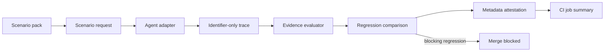

# Building the Agent Assurance Harness

This document explains the engineering judgment behind the Agent Assurance Harness.
`GUIDE.md` explains how to operate and review the repository; this file explains how to
extend it without weakening the assurance boundary.
`PRODUCTION_DELIVERY_STANDARD.md` is the reusable, technology-neutral standard for
deciding whether a future build can reach production through an observable and
recoverable delivery path.

The project exists because a green test can still be misleading. An agent may use the
wrong tool, skip a required check, answer without usable evidence, retry a protected write
unsafely, or pass an evaluator that never checked the important condition. The harness
turns those failure modes into small, observable, repeatable contracts.

## The design thesis

The harness does not attempt to produce one universal “agent quality” score. It asks a
narrower question:

> For this declared task, what observable evidence must exist before the agent may claim
> success, answer, or perform a protected side effect?

That choice is deliberate. A single score can hide the difference between a correct task
outcome, complete evidence, safe abstention, and authorized action. These properties are
reported as separate assurance dimensions so a reviewer can see which property changed.

The harness is intentionally synthetic and provider-neutral by default. It demonstrates
the control without requiring credentials, private data, network access, or raw provider
output.

## Architecture



The important boundary is the trace. It carries tool names, statuses, synthetic
identifiers, source identifiers, numeric evidence age, authorization references, and
outcome classifications. It does not carry prompts, hidden reasoning, raw arguments,
record contents, credentials, or provider text.

This is not a claim that identifiers are magically safe. It is a deliberately narrow
public-repository contract: only fields that the evaluator needs may cross the boundary.
Anything else is refused or omitted.

## Failure model

Each built-in scenario has four parts:

1. A named failure mode that could make a result appear acceptable.
2. An evidence contract that states what must be observable.
3. A naive path that demonstrates the failure.
4. A guarded path and evaluator test that demonstrate the expected control.

The current progression is intentionally operational:

| Phase | Failure or control | What it makes visible |
|---|---|---|
| 1 | Evidence contracts and synthetic failure cases | Which facts are required before a result passes |
| 2 | Ambiguous timeout, retry identity, and reconciliation | Why a retry response is not proof of one committed write |
| 3 | Authorization binding and action digests | Whether approval belongs to this operation and action |
| 4 | Execution budgets | Whether request, token, time, and spend ceilings were enforced |
| 5 | Pull-request assurance summaries | Whether reviewers can see the decision and provenance in CI |
| 6 | Evidence source and freshness | Whether evidence is from the approved source and within its age window |
| 7 | Golden Trace baseline | Whether canonical successful evidence drifted even when status still passes |
| 8 | Operational ship gate | Who notices a failure, what blocks release, how to roll back, and what audit record remains |
| 9 | Audit evidence binding | Whether the release record is complete and matches the current checkout and approved baseline |
| 10 | Provider adapter assurance | Whether provider-shaped adapters use the shared gate, preserve credential boundaries, and enforce budget refusals |
| 11 | Provider contract drift | Whether reviewed provider response shapes remain accepted and unsafe changes are refused |
| 12 | Rollback rehearsal | Whether a controlled artifact failure can be detected and restored without external side effects |
| 13 | Release artifact assurance | Whether the exact clean package artifact and SBOM were produced by the checked source state |
| 14 | Release provenance | Whether signed CI provenance covers the exact artifacts from the committed source state |
| 15 | Release promotion | Whether an explicitly approved, provenance-verified artifact may proceed to a future release boundary |
| 16 | Reusable GitHub Action | Whether another repository can consume the same bounded assurance contract and structured decision |
| 17 | Evidence-quality abstention | Whether stale or wrong-source evidence produces abstention with a diagnostic failure reason |
| 18 | Consumer repository validation | Whether a separate repository can invoke the pinned action, pass a guarded adapter, and block a degraded adapter |
| 19 | Consumer policy and escalation | Whether a consumer binds adapter evidence to policy, scope, and escalation expectations |
| 20 | Policy-drift replay and restoration | Whether policy drift blocks the consumer path and restoring the approved policy returns it to pass |
| 21 | Policy replay provenance | Whether the replay identifies the exact checkout, action revision, manifest bytes, and result sequence |
| 22 | Independent replay provenance verification | Whether a separate pull-request check recomputes and enforces the replay evidence |
| 23 | Action-pin and contract migration | Whether consumers explicitly declare compatible action and evidence schema versions |
| 24 | Pinned action content parity | Whether the exact immutable action revision contains the required consumer-policy input and runner wiring |
| 27 | Claim-level content assurance | Whether a fresh approved source actually supports each declared claim |

The phases are not claims that these are the only production failures. They are a growing
set of concrete controls with explicit limits.

## What counts as evidence

An `EvidenceContract` is the machine-readable contract for one scenario. Each requirement
uses a fixed identifier prefix, such as `tool:`, `successful_tool:`, `authorization:`,
`side-effect:`, `output:`, or `abstain:`.

The prefix is a protocol boundary, not decoration. It lets the declarative pack evaluator
remain limited to known checks instead of executing arbitrary predicates supplied by a
pack.

Successful tool-result requirements may also declare:

- `source`: the approved source identifier; and
- `max_age_seconds`: the maximum permitted age of that evidence.

Both values are metadata, not record content. The evaluator rejects a result when the
source is wrong, the age is missing, or the age exceeds the declared limit. This catches
“right answer from stale cache” failures without exporting the record that was retrieved.

Phase 17 makes the rejection paths explicit. It tests approved-but-stale evidence and
fresh-but-wrong-source evidence separately, requires abstention for each, and records
`evidence_stale` or `evidence_wrong_source` so a freshness-only evaluator cannot pass the
wrong-source case. The failure reason is an identifier, not the retrieved record.

Phase 27 adds the claim-support layer. A source can be official, fresh, and unchanged
while still failing to support a particular statement. The synthetic source registry
therefore records only a claim identifier and one of four support states:
`supported`, `unsupported`, `conflicting`, or `ambiguous`. The agent approves only
`supported`; the other states produce `claim_unsupported`, `claim_conflict`, or
`claim_ambiguous` abstention reasons. If source authority, freshness, or integrity
fails first, claim support is marked `skipped` rather than treated as a pass.

## How to add a control

Add one complete vertical path, in dependency order:

1. **Name the failure.** State what can go wrong and what a reviewer would observe first.
2. **Write the contract.** Define the minimum evidence and the strongest claim it does not
   establish.
3. **Add the synthetic environment.** Return identifiers and classifications only.
4. **Add naive and guarded traces.** The naive trace must fail for the intended reason; the
   guarded trace must pass for the intended reason. If evidence is invalid but present,
   include a guarded abstention trace and assert the exact failure reason.
5. **Add a mutation.** Remove, replace, stale, or misbind the evidence and prove the
   evaluator catches it.
6. **Propagate the fields.** Update the recorder, subprocess protocol, provider-shaped
   adapters, OTLP importer, MCP schema, replay fixture, and report if the new evidence
   crosses those boundaries.
7. **Test the privacy boundary.** Include a test showing that raw content or an unknown
   field is refused without being echoed.
8. **Update operator documentation.** Explain how to read the result, what it proves, and
   what it does not prove.
9. **Run the delivery checks.** The relevant path must pass unit, integration, boundary,
   dependency, lock, and release checks before it is considered complete.

This order matters. Adding a field only to the evaluator creates a local demo that can
disappear at the first serialization boundary.

### Golden Trace rule

The Golden Trace is a baseline for canonical observable evidence, not a snapshot of
prompts or model internals. Its digest includes tool-result identifiers and statuses,
source and age metadata, authorization and retry identity, abstention, and other fields
the evaluator uses. It excludes free-form claim and answer wording so a harmless wording
change does not become a false safety alarm.

The checked-in baseline is refreshed only after review because refreshing it can turn an
unreviewed behavior change into the new expected behavior. The manifest is tied to the
current scenario-pack set, so a pack change cannot silently reuse an old baseline.

## Decision record format

For any decision a competent engineer could reasonably make another way, record:

```text
Decided: <the choice>
Instead of: <the credible alternative>
Why: <the consequence that made this choice better>
Costs if wrong: <what becomes harder or unsafe>
Decided by: <person or review authority>
```

The alternative is required. Without it, a later reviewer cannot tell whether the design
was deliberate or simply the first implementation that worked.

Examples from this build:

- Keep the public harness synthetic and metadata-only instead of adding live credentials
  or a hosted service, because the repository must demonstrate the control without
  publishing protected material. The cost is that live-model behavior remains untested.
- Extend `successful_tool:` with source and age instead of adding a new requirement
  prefix, because the existing protocol already describes successful evidence. The cost
  is that the requirement has a more detailed shape.
- Accept legacy version-2 custom packs instead of forcing an immediate migration, because
  older synthetic packs do not need the new optional metadata. The cost is that source and
  freshness checks require the current pack schema.

## Privacy and security boundary

The public repository must remain synthetic-only. Never add:

- credentials or credential values;
- environment dumps;
- prompts or hidden reasoning;
- customer, candidate, exam, or internal content;
- raw provider requests or responses;
- raw tool arguments or results;
- unrestricted file or network access to the MCP server; or
- a claim that metadata is a signed provenance statement when it is not.

The MCP server is read-only. The external adapter boundary uses an argument vector rather
than a shell, limits response and diagnostic output, and applies timeout and best-effort
resource ceilings. These controls reduce accidental exposure and runaway execution; they
are not a complete sandbox for hostile code.

The live provider path is intentionally separate from the default CI path. Provider
credentials are referenced by environment-variable name, not stored or logged. Adding a
real provider requires a new review of credential handling, request limits, spend limits,
privacy, network access, and rollback.

## CI and production path

The CI workflow is a pre-merge assurance gate: a repeatable check that runs before a
change is accepted into the main branch. It:

- compares a baseline adapter with a candidate adapter;
- blocks safety and evidence regressions;
- runs a deliberately degraded negative control;
- verifies the Git revision and scenario-pack fingerprints;
- renders metadata-only evidence in the GitHub Actions job summary; and
- proves that credentials, prompts, traces, and provider output are not exported.

The next production integration is not “turn on a model and trust the score.” It is:

1. instrument a real adapter at the identifier-only boundary;
2. select scenarios that match the real tool and side-effect risks;
3. set explicit request, token, time, memory, and spend ceilings;
4. run the harness in pre-merge CI with a known-good baseline;
5. review failures and refusals as evidence gaps, not just test failures;
6. add deployment, monitoring, rollback, and incident controls around the live system;
7. keep live-model evaluation and production monitoring as separate evidence sources.

The harness can support that path, but its synthetic gate does not replace those controls.

## Repository map

- `GUIDE.md` — operator and reviewer path.
- `BUILD_GUIDE.md` — design rationale and extension path.
- `PRODUCTION_DELIVERY_STANDARD.md` — reusable production-delivery controls for future builds.
- `src/agent_reliability_lab/models.py` — immutable trace and evidence records.
- `src/agent_reliability_lab/scenarios.py` — Python parity controls and reference agents.
- `src/agent_reliability_lab/scenario_packs/` — validated declarative synthetic packs.
- `src/agent_reliability_lab/recorder.py` — provider-neutral recording boundary.
- `src/agent_reliability_lab/external.py` — subprocess protocol and safety limits.
- `src/agent_reliability_lab/providers.py` — reviewed OpenAI- and Anthropic-shaped
  synthetic translations.
- `src/agent_reliability_lab/otlp.py` — constrained local OTLP normalization.
- `src/agent_reliability_lab/mcp_server.py` — read-only typed MCP surface.
- `tools/` — release, regression, boundary, and evidence-summary checks.
- `tests/` — unit, integration, negative-control, protocol, and privacy tests.
- `.github/workflows/reliability.yml` — pull-request assurance workflow.
- `examples/traces/golden-manifest.json` — metadata-only Golden Trace identity.
- `tools/golden_trace_report.py` — Golden Trace comparison and drift gate.
- `examples/ship-gate.json` — synthetic operational ownership, blocking, rollback, audit, and stop-condition contract.
- `tools/ship_gate_report.py` — release-readiness decision from metadata-only assurance reports.
- `src/agent_reliability_lab/provider_assurance.py` — shared provider-shaped positive and budget-negative controls.
- `tools/provider_assurance_report.py` — metadata-only provider adapter assurance report.
- `src/agent_reliability_lab/provider_contract.py` — fixture fingerprints and safe response-contract checks.
- `examples/provider-contract-manifest.json` — approved provider fixture hashes and negative controls.
- `tools/provider_contract_report.py` — provider contract drift and refusal gate.
- `src/agent_reliability_lab/rollback_rehearsal.py` — disposable artifact failure and restoration rehearsal.
- `examples/rollback-plan.json` — strict no-network, no-write rollback rehearsal policy.
- `tools/rollback_rehearsal.py` — metadata-only rollback rehearsal report.
- `tools/release_check.py` — clean source/wheel parity, dependency SBOM, and release manifest.
- `src/agent_reliability_lab/provenance.py` — signed artifact-subject verification records.
- `tools/provenance_report.py` — metadata-only GitHub attestation verification.
- `src/agent_reliability_lab/release_promotion.py` — exact-evidence promotion decision and tamper check.
- `tools/release_promotion_report.py` — metadata-only pre-release promotion report.
- `.github/actions/agent-assurance/action.yml` — pinned-revision reusable consumer action.
- `tools/reusable_action_runner.py` — JSON-argument-vector action runner and metadata-only outputs.
- `examples/reusable-action-consumer.yml` — consumer workflow example.
- `examples/consumer-repository/` — separate synthetic consumer fixture with positive and negative adapter workflows.
- `src/agent_reliability_lab/consumer_contract.py` — metadata-only policy, scope, and escalation contract evaluator.
- `examples/consumer-repository/policy-manifest.json` — checked-in synthetic consumer policy declaration and digest.
- `examples/consumer-repository/policy-manifest-drifted.json` — valid but deliberately mismatched policy declaration.
- `tools/consumer_validation.py` — local metadata-only consumer validation and workflow contract check.
- `tools/verify_consumer_provenance.py` — independent metadata-only verifier for consumer replay evidence.
- `src/agent_reliability_lab/consumer_compatibility.py` — action-pin and report-version compatibility evaluator.
- `examples/consumer-repository/compatibility-manifest.json` — checked-in consumer migration contract.
- `src/agent_reliability_lab/action_parity.py` — required reusable-action contract markers and metadata-only parity result.
- `tools/verify_pinned_action.py` — verifies the required action behavior at the exact pinned Git revision.
- `skills/agent-assurance-harness/SKILL.md` — reusable workflow instructions for future harness changes.
- `src/agent_reliability_lab/content_assurance.py` — synthetic technical-content assurance agent and controls.
- `examples/content-assurance-packs/` — seven declarative synthetic packs for fresh,
  stale, wrong-source, source-drift, unsupported-claim, conflicting-claim, and
  ambiguous-claim evidence.
- `examples/content_assurance_adapter.py` — JSONL adapter that exercises the content
  assurance agent through the same external protocol used by CI.
- `src/agent_reliability_lab/public_sources.py` — bounded official-source metadata refresh.
- `tools/content_assurance_report.py` — metadata-only content assurance suite.
- `tools/refresh_public_sources.py` — explicit real-source refresh without body persistence.

### Audit evidence binding

Phase 9 makes the audit section enforceable. The ship-gate report now carries the
observed Git revision, package version, scenario-pack SHA-256, Golden Trace
SHA-256, and final decision. It compares those values with the current checkout
and the approved Golden Trace manifest. A stale report, missing identifier, or
cross-report mismatch blocks the gate.

The report remains metadata-only: hashes and identifiers are visible, while
prompts, traces, provider output, credentials, and private contacts remain
excluded.

### Provider adapter assurance

Phase 10 makes the provider boundary a required CI check. Both mocked
OpenAI-shaped and Anthropic-shaped adapters run through the same scenario
evaluator, and a deliberately over-budget run must produce structured
refusals. The report records credential environment-variable names and
explicitly records that credential values were not observed; it never reads a
credential value.

The live provider boundary remains separate and disabled in CI. This phase
proves the adapter contract, privacy boundary, and budget enforcement without
making a network call or claiming live-provider quality.

### Provider contract drift

Phase 11 fingerprints the reviewed OpenAI- and Anthropic-shaped fixture bytes
and JSON shapes, then sends the fixtures through the same response extractor and
safe translator used by the live boundary. A changed approved fixture, a
positive fixture that no longer translates, or a negative fixture that is
accepted blocks the ship gate.

The manifest contains hashes and fixture names only. Provider content is not
copied into the report, and the gate makes no network call.

### Rollback rehearsal

Phase 12 turns the ship-gate rollback declaration into an executable control.
The rehearsal archives the current Git revision, extracts it into a temporary
last-known-good directory, injects a synthetic release marker into a separate
failed copy, and extracts the archive again as the restored artifact. It
requires the failed and original tree hashes to differ and the restored and
original hashes to match. The restored hash is also bound into the ship-gate
audit record, so a report cannot claim restoration without carrying the
artifact identity.

This is intentionally a rehearsal rather than a deployment action. It does not
modify the checkout, run `git revert`, contact a deployment target, or inspect
external state. That keeps the public CI control safe and deterministic, but
the cost is material: it cannot prove that a production database, queue,
provider session, or other stateful dependency would recover.

### Release artifact assurance

Phase 13 makes the release build part of the blocking ship decision. The
existing release check already builds a source distribution and wheel,
installs the wheel into a clean environment, compares its synthetic assurance
output with the source checkout, and generates a runtime SBOM. This phase
adds a strict release-artifact observation to the ship gate and binds the
source distribution, wheel, and SBOM SHA-256 values to the audit record.

The gate also requires a clean checkout, the current Git revision and package
version, successful parity checks, a persisted SBOM, and non-empty scenario
pack fingerprints. It does not sign or publish the artifact and cannot prove
that a deployment system accepted it; those are separate delivery controls.

### Release provenance

Phase 14 adds a push-only provenance gate after the read-only assurance job.
The workflow uses `actions/attest@v4` to create signed provenance for the
source distribution and wheel, then `gh attestation verify` checks the exact
local SHA-256 subjects, SLSA provenance predicate, repository, signer
workflow, and source commit.

The attestation permissions are scoped to the separate push job. Pull-request
runs do not receive `id-token: write` or `attestations: write`, because an
untrusted change must not receive authority to create release identity
evidence. The resulting report is metadata-only. It proves build identity,
not deployment health, package correctness, or acceptance by a deployment
system.

### Release promotion

Phase 15 adds a manual, main-branch-only promotion decision after provenance.
The workflow requires an explicit approval input and the protected `release`
environment. It downloads the exact evidence bundle from the provenance job
and rechecks the artifact bytes, provenance report, release manifest, rollback
rehearsal, source commit, and approval identity.

The public repository stops at this decision. A future publisher or deployment
system can consume the metadata-only result, but no package is published and no
deployment is attempted here. The `release` environment must be configured
with required reviewers outside the repository; declaring the environment in
YAML does not create that reviewer policy.

### Reusable GitHub Action

Phase 16 turns the assurance contract into a consumer-facing action without
duplicating the full workflow. The action installs the harness from its own
revision, runs the caller's adapter in a bounded subprocess, validates built-in
or caller-supplied scenario packs, writes a metadata-only report, uploads that
report, and exposes `decision` and `passed` outputs.

The input is a JSON argument vector rather than a shell command string. This
preserves the existing `shell=False` boundary and prevents a caller's command
text from becoming an unintended shell program. Consumers should pin the action
to a reviewed commit and use a separate runner or container if the adapter
itself is untrusted; the action constrains the protocol boundary but is not an
operating-system sandbox.

### Consumer repository validation

Phase 18 exercises the reusable action from a separate synthetic consumer
repository fixture instead of only testing the action from inside its source
repository. The fixture uses a standard-library-only adapter and pins both its
positive and deliberately degraded workflow steps to the reviewed Phase 17
commit.

`tools/consumer_validation.py` runs the same bounded subprocess runner locally
for both adapters. It requires the guarded adapter to pass, requires the
degraded adapter to return a blocked decision, checks that the fixture has
read-only permissions and no moving `@main` reference, and emits only
metadata. The root reliability workflow runs this check and uploads its
metadata-only report with the other assurance evidence.

This proves that the reusable action's consumer contract is exercised outside
the harness's normal example adapter. It does not prove GitHub-hosted runner
availability, live-provider quality, or consumer-specific deployment behavior.

### Consumer policy and escalation contract

Phase 19 extends the consumer contract without adding a second runner. A
consumer may provide a checked-in policy manifest to the action. The harness
checks the manifest's canonical SHA-256 binding across the scenario traces,
the required authorization scope for a protected write, and an explicit
escalation status and identifier for an unsupported request.

The degraded fixture changes all three controls. Its report remains
metadata-only and uses stable failure reasons, which makes a pull request
reviewable without exporting prompts, traces, provider output, credentials, or
private content. This proves pre-merge representation and enforcement, not live
IAM, vault, gateway, deployment, or human-response behaviour.

### Policy-drift replay and restoration

Phase 20 reuses the consumer action path to evaluate the same guarded adapter
against three policy states: the approved manifest, a valid but drifted
manifest, and the approved manifest again. The drifted state must block for
policy-version and policy-digest mismatch. The final approved state must pass,
which is the local rollback evidence.

The report exposes only decisions, stable failure reasons, action identity, and
the `rollback_restored` result. It does not claim that a live policy registry,
deployment target, or production authorization system was rolled back.

### Policy replay provenance

Phase 21 binds the three-state replay to the current Git commit, the reviewed
action revision, and SHA-256 fingerprints of the approved and drifted manifest
bytes. It records the `pass → blocked → pass` state sequence beside those
identifiers so a reviewer can distinguish current evidence from a stale replay.

These are local identity fingerprints, not signed provenance and not proof of
production state. The consumer fixture now pins the action to the reviewed
Phase 20 commit because that is the first revision containing the policy-manifest
input.

### Independent replay provenance verification

Phase 22 runs a separate verifier after consumer validation in the pull-request
workflow. It recomputes the current Git commit and both manifest fingerprints,
derives the expected action revision from the checked-in consumer workflow, and
requires the complete `pass → blocked → pass` sequence.

The verifier exists as a separate process because a report producer must not be
the only code deciding that its own provenance is correct. It reports hashes,
identifiers, and states only; it does not inspect or export adapter payloads.

### Action-pin and contract migration

Phase 23 adds an explicit compatibility manifest for the synthetic consumer.
It requires the reviewed action commit, reusable-action report version,
consumer-validation report version, and policy-manifest version. Every positive,
negative, drift, and restored run must satisfy those requirements.

This makes an action upgrade or downgrade a reviewed migration decision. A
consumer cannot silently use an older action that lacks the policy-manifest
input while the local validator evaluates newer code.

### Pinned action content parity

Phase 24 verifies the action object at the exact immutable commit named by the
consumer workflow. It requires the policy-manifest input, its environment wiring,
the reusable runner path, and the policy-manifest argument to be present at that
revision.

This is content parity: the required behavior exists in the pinned revision. It
is not byte-for-byte equality with the current action file, because unrelated
comments or implementation improvements should not force a consumer migration.
The CI checkout uses full history so the verifier can inspect that historical Git
object without network access or credentials. A missing marker blocks the gate.

### Technical content assurance and official-source refresh

Phase 25 adds the first production-shaped reference agent for the public flagship use
case: technical training and enablement content. The agent checks synthetic content
claims against a source registry and makes the publication decision explicit:
`approved`, `abstain`, or `refused`.

The checks separate four failure modes:

- missing or unknown verification evidence;
- evidence outside the freshness window;
- fresh evidence from a source that is not approved; and
- source drift, where the current source fingerprint no longer matches the claim
  contract.

This deliberately reuses the smaller builds instead of merging their repositories:
the artifact `reuse_key` carries the content-corpus reuse question, source age and
fingerprints carry the course-doctor and driftwood concerns, and the harness retains
the shared abstention and metadata-only evidence contract.

The real-data boundary is explicit. `tools/refresh_public_sources.py` can read the
fixed official AWS, Anthropic, and OpenAI documentation roots on demand. It enforces
HTTPS, an official-host allow-list, a response-size ceiling, and a timeout; it hashes
the response bytes and discards the body. The generated manifest contains only URLs,
timestamps, byte counts, and hashes. CI uses synthetic fixtures so the blocking gate
remains deterministic and credential-free.

This phase does not yet parse or rewrite documentation, infer claim truth from prose,
or publish a course update. Those are later adapters and require their own evidence
contracts.

The reference agent is now exercised through the existing adapter boundary with seven
declarative packs under `examples/content-assurance-packs/`. A custom-pack conformance
report proves the approval and abstention reasons survive JSONL serialization. The
operational ship gate requires both the domain report and the adapter-conformance
report, because a domain decision that cannot survive its integration boundary is not
production evidence.

### Operational ship gate

Phase 8 makes the delivery path (the route a change takes from code review to a
release decision) operationally explicit. `examples/ship-gate.json` records a
synthetic owner and observer, the checks that block release, the rollback target,
the metadata required for audit, and the stop condition for a run.

The gate is evaluated with:

```bash
uv run python tools/ship_gate_report.py \
  --gate examples/ship-gate.json \
  --adapter-regression-positive /tmp/agent-reliability-adapter-regression.json \
  --golden-trace-positive /tmp/agent-reliability-golden-trace.json \
  --adapter-regression-negative-control /tmp/agent-reliability-negative-regression.json \
  --golden-trace-negative-control /tmp/agent-reliability-golden-negative.json \
  --fail-on-block
```

The command returns `READY` only when the positive checks pass and both
deliberately degraded controls are caught. A missing report is a blocked
decision, not an empty success. The rollback value is a public synthetic
contract, not an automated deployment action.

## Review checklist

Before merging a harness change, ask:

- What failure does this change make observable?
- What evidence is required before success is allowed?
- What does the result explicitly not prove?
- Is there a naive or degraded negative control?
- Can the evaluator be fooled by missing, stale, or wrong-source evidence?
- Does the evidence survive every serialization boundary?
- Does any new field permit raw content, credentials, or unrestricted access?
- Are time, memory, request, token, and spend limits explicit?
- Can CI show the decision and provenance without requiring a reviewer to reconstruct it?
- Is rollback just a Git revert, with no hidden external state?

If the answer to any of these is unclear, the change is not finished documentation-wise,
even if the tests are green.
