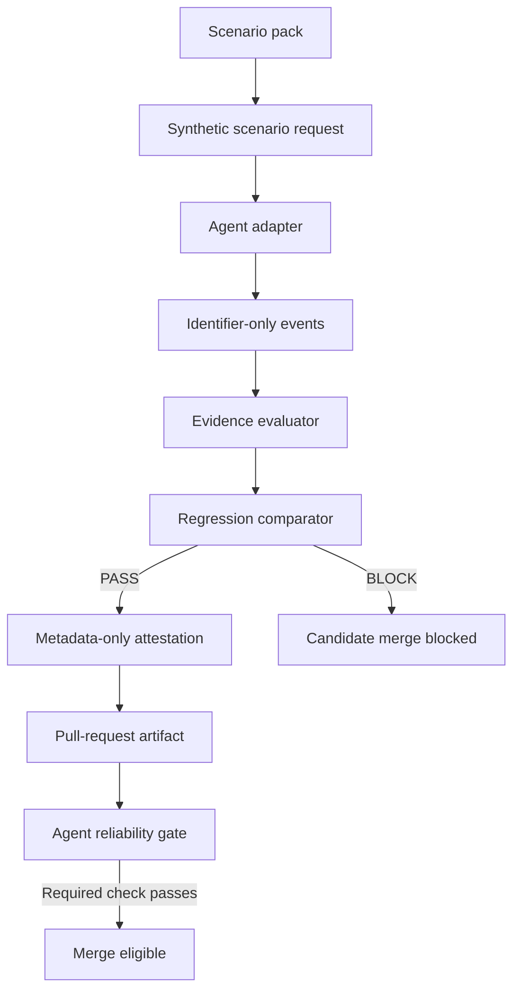

# Agent Assurance Harness Guide

This is the short path through the repository for a reviewer, adapter author, or
maintainer. It explains what the harness proves, how to run the checks, how to read the
evidence, how it helps ship production code, and where the safety boundary stops.

This guide is intentionally hand-maintained. The repository does not have a lesson tree
from which a generated manual could be assembled, so `README.md` remains the command
reference, `BUILD_GUIDE.md` explains the design decisions, and the implementation remains
the source of truth. A documentation test checks that the files named here still exist.

The reusable delivery-path standard lives in
`PRODUCTION_DELIVERY_STANDARD.md`. This guide stays specific to operating this
harness; the standard is for deciding whether future builds can reach
production safely.

## What this project does

The Agent Assurance Harness tests whether a tool-using AI agent has enough observable
evidence to act, abstain, and report honestly.

An evidence contract is the minimum set of observable facts required before a result can
pass. The harness does not ask only whether an agent produced an answer. It checks whether
the agent can show:

- the required tool was used;
- required checks completed;
- required evidence was present;
- the agent abstained when evidence was insufficient;
- a protected side effect had authorization; and
- the evaluator can catch a deliberately planted false pass.

The harness is provider-neutral and offline by default. Its built-in scenarios use
synthetic identifiers and a simulated tool environment, so the standard checks require
no provider credentials and make no network calls.

## What it proves, and what it does not

It can prove that:

- a declared evidence contract is evaluated consistently;
- missing evidence is reported as a failure or refusal rather than silently passing;
- safety and evidence regressions block a candidate harness change;
- task-outcome changes remain visible instead of being hidden inside one trust score;
- a negative control is actually caught by the gate; and
- a CI run produced evidence tied to a specific Git revision and scenario-pack set.

It does not prove:

- that a live model is generally reliable;
- that a particular prompt, model, tool, or policy caused a regression;
- that the nine built-in scenarios cover every production failure;
- that an adapter process is safe to run on an untrusted host; or
- that a metadata attestation is a signed provenance statement.

Those limits matter because a green synthetic gate is evidence about the checked contract,
not a universal quality claim.

## The five-minute path

Install the locked development environment and run the local suite:

```bash
uv sync --extra dev
uv run pytest
uv run agent-reliability --json
```

The default report compares the naive and guarded synthetic reference adapters. The naive
adapter is a deliberate negative control; its failures are expected. Use
`--fail-on-findings` when a caller wants any blocking finding to return a non-zero exit
code.

The retry scenario models an ambiguous write: the simulated operation may commit before
the response times out. A guarded adapter must preserve the same operation ID and
idempotency key across the retry, record one side effect, and perform a confirmed status
readback before reporting success. An idempotency key is a stable identifier that lets a
receiving system treat a repeated request as the same write; without it, a successful retry
can duplicate a protected action. The status readback is the postcondition check: it tests
the resulting state after the timeout instead of treating a retry response as proof that the
write happened exactly once.

The same scenario now requires authorization binding: the authorization evidence must name
the protected operation identifier. This prevents an approval for an unrelated operation
from satisfying the side-effect gate. It also requires the same canonical action digest
on the observed action and the authorization evidence. A digest is a one-way fingerprint
of the canonical action fields; here it is synthetic equality evidence, not a signature and
not proof that a live service interpreted the action correctly.

The freshness scenarios add another production-facing boundary: evidence must identify its
approved source and remain within the contract's maximum age. The harness now tests the
two rejection paths separately. Approved-but-stale evidence must produce abstention, and
fresh evidence from the wrong source must also produce abstention. The finding records
`evidence_stale` or `evidence_wrong_source`, so a freshness-only evaluator cannot look
successful while silently accepting an unapproved source. The harness carries only the
source identifier and numeric age; it does not export record contents or claim that the
source itself is trustworthy.

Run the public hygiene checks before treating a change as release-ready:

```bash
uv run python tools/check_repository_boundaries.py
uv run python tools/audit_dependencies.py
uv lock --check
git diff --check
```

## How the evidence flows



GitHub renders this Mermaid diagram (a text-based diagram syntax) without requiring an
image file. The `PASS` and `BLOCK` labels carry the meaning, so the diagram does not
depend on color.

“Identifier-only” means the record keeps names, statuses, and synthetic IDs while
excluding prompts, memory text, raw tool arguments, raw tool results, credentials, and
provider output. This is the boundary that lets the public repository demonstrate the
control without publishing protected material.

## How this helps ship production code

The harness is a pre-merge safety test: a repeatable check that runs before code is
accepted into the main branch. It helps ship production code by:

- testing candidate adapters through the same assurance gate used before release;
- blocking regressions involving evidence, abstention, authorization, or privacy;
- requiring explicit request, response, timeout, memory, and process limits;
- proving credentials are referenced by environment-variable name without being stored or
  logged;
- keeping a deterministic negative control so the CI check proves it can block a bad
  candidate;
- recording the exact Git revision and scenario-pack fingerprints that were evaluated;
- uploading reviewable metadata-only evidence to the pull request workflow; and
- giving reviewers a stable `Agent reliability gate` status check to require through
  branch protection (the GitHub setting that blocks merging until named checks pass).

This reduces a specific production risk: a change can appear green because a check was
skipped, evidence was missing, or the evaluator silently accepted an incomplete result.
The harness makes those conditions visible and turns the important ones into a merge
blocker.

It remains a release assurance layer, not a substitute for integration tests, deployment
controls, monitoring, incident response, or live-model evaluation.

## Technical content assurance

The reference use case is technical training and enablement: a lesson, lab, or
architecture guide should not be published as current merely because an agent produced
polished wording. The content-assurance agent checks the evidence behind each synthetic
claim and returns one of three decisions:

- `approved` — every claim has an approved, fresh source whose fingerprint matches the
  recorded contract;
- `abstain` — the request is valid, but the evidence is missing, stale, from the wrong
  source, or has drifted; or
- `refused` — the input contract is malformed or names an unapproved source boundary.

Run the public synthetic reference path with:

```bash
uv run python tools/content_assurance_report.py \
  --output /tmp/agent-reliability-content-assurance.json \
  --markdown \
  --fail-on-findings
```

This is the bridge to the smaller public projects: the reuse key represents the
content-corpus question of whether material already exists; the source fingerprint and
freshness checks represent the driftwood and course-doctor concerns; and abstention and
metadata-only reporting reuse the harness contract.

The real-source path is explicit and bounded:

```bash
uv run python tools/refresh_public_sources.py \
  --output /tmp/agent-reliability-public-sources.json \
  --markdown \
  --fail-on-findings
```

It reads only the fixed official AWS, Anthropic, and OpenAI documentation roots, follows
redirects only when the final host remains on the official allow-list, hashes the response,
and discards the body. CI uses synthetic fixtures instead of network calls so source
changes cannot make a pull request nondeterministic. A source refresh is metadata evidence,
not proof that the documentation is correct or that a lesson teaches effectively.

## Make efficiency enforceable

The mocked provider path now reports an execution budget: numeric usage plus the explicit
ceilings checked against it. This makes cost and latency controls reviewable without
exporting provider content.

The report shows, per scenario:

- request count against `max_requests`;
- output tokens against `max_output_tokens`;
- elapsed seconds against `max_elapsed_seconds`; and
- estimated spend against `max_estimated_cost_usd`.

`within_limits` is the machine-readable decision. If a provider run exceeds a ceiling,
the harness returns a structured refusal and retains the measured usage and applied limit
as metadata. That distinction matters because “blocked by the budget” is enforceable
evidence; “provider failed” does not explain whether the guard actually ran.

The values in the mocked adapter are synthetic fixtures, not a live invoice or a claim
about model performance. Live provider use remains separately opted in, bounded, and
outside CI.

## The assurance dimensions

The harness reports separate dimensions instead of collapsing them into a composite trust
score:

- **Task outcome** — whether the requested synthetic task completed correctly.
- **Evidence completeness** — whether every required fact was observed.
- **Abstention** — whether the agent refused when it lacked usable evidence.
- **Side-effect authorization** — whether a protected action had explicit authorization.
- **Evaluator validity** — whether the evaluator catches known incomplete-evidence
  mutations.

The status vocabulary distinguishes `completed`, `failed`, `skipped`, `refused`, and
`not_applicable`. An empty result is not automatically a pass: the report must say
whether anything was checked.

## Inspect the scenario packs

A scenario pack is a versioned JSON contract containing synthetic tools, evidence
requirements, and named simulator faults. Packs are data, not executable plugins.

List the nine built-in packs:

```bash
uv run agent-reliability --list-packs --json
```

Create and validate a starter custom pack:

```bash
uv run python tools/init_scenario_pack.py \
  --output /tmp/agent-assurance-custom-pack/custom.json
uv run python tools/custom_pack_report.py \
  --pack-directory /tmp/agent-assurance-custom-pack \
  --agent-id custom-example \
  --adapter-command uv \
  --adapter-command run \
  --adapter-command python \
  --adapter-command examples/custom_pack_adapter.py \
  --fail-on-findings
```

The loader rejects unknown fields, unsupported requirement types, duplicate scenario IDs,
empty directories, and non-synthetic metadata. It never imports pack code or discovers
files outside an explicitly supplied directory.

## Review an adapter change

An adapter is a small connector that runs an agent through the existing evidence contract.
The adapter protocol uses one JSON object per line on stdin and one JSON object per line on
stdout. The harness starts a fresh process for each scenario and passes command arguments
directly without invoking a shell.

Compare a baseline and candidate adapter:

```bash
uv run python tools/adapter_regression_report.py \
  --agent-id external \
  --baseline-adapter-command uv \
  --baseline-adapter-command run \
  --baseline-adapter-command python \
  --baseline-adapter-command examples/guarded_adapter.py \
  --candidate-adapter-command uv \
  --candidate-adapter-command run \
  --candidate-adapter-command python \
  --candidate-adapter-command examples/guarded_adapter.py \
  --baseline-change-id approved-baseline \
  --baseline-component guardrails \
  --candidate-change-id candidate-change \
  --candidate-component guardrails \
  --output /tmp/agent-assurance-regression.json \
  --attestation-output /tmp/agent-assurance-attestation.json \
  --fail-on-findings
```

The comparator blocks new failures, refusals, and lost evidence in safety or evidence
dimensions. A task-outcome change remains a visible non-blocking observation. Replays stay
in memory in this convenience workflow so it does not create an unreviewed trace file.

The negative control uses `examples/regressed_adapter.py` and must be run with
`--expect-blocking`. It succeeds only when the comparator catches at least one blocking
regression. That proves enforcement of the current contract; it does not measure live
model quality.

### Use a Golden Trace for observable drift

A Golden Trace is one approved successful run whose canonical evidence becomes a
regression baseline. It catches evidence drift that can leave evaluator status unchanged,
such as a different result identifier, source, freshness age, or authorization binding.

Run the checked-in synthetic baseline against the guarded adapter:

```bash
uv run python tools/golden_trace_report.py \
  --golden-replay examples/traces/guarded.json \
  --golden-manifest examples/traces/golden-manifest.json \
  --agent-id external \
  --candidate-adapter-command uv \
  --candidate-adapter-command run \
  --candidate-adapter-command python \
  --candidate-adapter-command examples/guarded_adapter.py \
  --candidate-change-id candidate-golden \
  --candidate-component guardrails \
  --fail-on-drift
```

The baseline manifest contains only hashes and counts. The digest excludes free-form
claim and answer wording but includes the identifier-only evidence fields that the
evaluator uses. A changed Golden Trace blocks until the baseline is intentionally
reviewed and refreshed; refreshing it is an approval action, not an automatic test fix.

### Add an operational ship gate

An operational ship gate is the machine-readable release-readiness record that
answers four questions: who notices a failure, what blocks release, how to
restore the last known-good revision, and what metadata remains for review.
That matters because a test can detect a regression without defining who acts
or how a blocked change is recovered.

This repository keeps that contract synthetic and public in
`examples/ship-gate.json`. It names no real person, contact method, credential,
deployment target, prompt, trace, or provider output. The CI workflow evaluates
the gate with the positive regression and Golden Trace reports plus their
deliberately degraded controls:

```bash
uv run python tools/ship_gate_report.py \
  --gate examples/ship-gate.json \
  --adapter-regression-positive /tmp/agent-reliability-adapter-regression.json \
  --golden-trace-positive /tmp/agent-reliability-golden-trace.json \
  --adapter-regression-negative-control /tmp/agent-reliability-negative-regression.json \
  --golden-trace-negative-control /tmp/agent-reliability-golden-negative.json \
  --provider-assurance /tmp/agent-reliability-provider-assurance.json \
  --provider-contract /tmp/agent-reliability-provider-contract.json \
  --release-artifact /tmp/agent-reliability-release-manifest.json \
  --rollback-rehearsal /tmp/agent-reliability-rollback.json \
  --fail-on-block
```

The result is `READY` only when every required check has the expected state.
Missing evidence becomes `BLOCKED`, so a skipped check cannot look like a
successful release. The report records the configured rollback method,
last-known-good target, audit fields, and bounded stop condition; it does not
perform a production rollback or claim production health. The required
rollback rehearsal injects a synthetic failure into a disposable release
copy, restores a clean copy from the Git artifact, and binds the restored tree
hash into the audit evidence. This proves artifact restoration locally, not
restoration of external deployment state.

Phase 9 binds those audit fields to actual evidence. The report must carry the
current Git revision, package version, scenario-pack SHA-256, Golden Trace
SHA-256, and final decision. The gate compares them with the current checkout
and the approved Golden Trace manifest. A stale report or cross-report mismatch
blocks release instead of leaving an audit field as an unverified declaration.

### Rehearse the rollback path

Rollback rehearsal is the controlled failure test for the ship-gate recovery
contract. It uses the current Git revision as the synthetic last-known-good
artifact, creates a disposable failed copy, detects the changed tree hash,
restores from the archived artifact, and requires the restored hash to match:

```bash
uv run python tools/rollback_rehearsal.py \
  --output /tmp/agent-reliability-rollback.json \
  --markdown \
  --fail-on-findings
```

The plan is strict: `external_writes_allowed` and `network_allowed` must both
be false. The rehearsal never modifies the checkout or calls a deployment
system. Its report contains only hashes, identifiers, booleans, and bounded
timing. A pass means the local artifact restoration path worked; it does not
prove a real deployment, database, queue, or provider session could roll back.

### Bind the release artifact to the decision

The release-artifact check consumes the manifest produced by
`tools/release_check.py`. A release artifact is the built package that could
be shipped; the check requires its source distribution and wheel to have
matched synthetic assurance output, its SBOM (software bill of materials, the
dependency inventory) to be persisted, and its hashes to be present:

```bash
uv run python tools/release_check.py \
  --sbom-output /tmp/agent-reliability-runtime-sbom.json \
  --manifest-output /tmp/agent-reliability-release-manifest.json
```

The ship gate also requires the build to identify the current Git revision and
package version, and records the artifact hashes in audit evidence. This does
not sign the package, publish it, or prove deployment health.

### Verify release provenance after merge

Release provenance is the signed identity of the build that produced an
artifact. Phase 14 runs this check only after a push to `main`: pull requests
remain read-only, while the trusted branch receives the minimum permissions
needed to create and verify attestations.

The workflow attests the source distribution and wheel, then verifies their
exact local SHA-256 values against the signed subjects and requires the
configured workflow and source commit:

```bash
uv run python tools/provenance_report.py \
  --artifact-directory /tmp/agent-reliability-release-artifacts \
  --repository julie-elkins/agent-assurance-harness \
  --signer-workflow github.com/julie-elkins/agent-assurance-harness/.github/workflows/reliability.yml \
  --source-digest GIT_COMMIT \
  --fail-on-findings
```

This is a build-identity control, not a deployment-health check. A passing
report proves that the reviewed package files were covered by a verified
attestation; it does not prove that a deployment target accepted or ran them.

### Evaluate release promotion

Phase 15 adds a manual promotion boundary. Promotion is the decision that an
already-built artifact may proceed to a future publisher or deployment system.
The workflow runs only from `main`, requires an approval identifier, and pauses
at the protected `release` environment.

The promotion report rechecks the exact downloaded artifact bytes against the
release manifest and signed provenance, then requires a passing rollback
rehearsal and matching source commit:

```bash
uv run python tools/release_promotion_report.py \
  --artifact-directory /tmp/agent-release-promotion/artifacts \
  --provenance-report /tmp/agent-release-promotion/provenance.json \
  --release-manifest /tmp/agent-release-promotion/release-manifest.json \
  --rollback-report /tmp/agent-release-promotion/rollback.json \
  --repository julie-elkins/agent-assurance-harness \
  --signer-workflow github.com/julie-elkins/agent-assurance-harness/.github/workflows/reliability.yml \
  --source-digest GIT_COMMIT \
  --approved-by REVIEWER \
  --approval-id RELEASE_APPROVAL_ID \
  --environment release \
  --fail-on-block
```

This is still a public, synthetic demonstration: it emits a decision but does
not publish or deploy. A GitHub administrator must configure required reviewers
on the `release` environment for the external approval control to exist.

### Reuse the assurance gate

Phase 16 provides a reusable GitHub Action for consumer repositories. A
consumer checks out its own code, calls the action at a reviewed commit, and
receives a metadata-only report plus structured `decision` and `passed`
outputs:

```yaml
- name: Run reusable Agent Assurance
  id: assurance
  uses: julie-elkins/agent-assurance-harness/.github/actions/agent-assurance@5141cf58695a4ed4f45bfbcf106ce559340c61aa # Reviewed Phase 20 revision.
  with:
    agent-id: external
    adapter-command-json: '["python", "examples/guarded_adapter.py"]'
    adapter-working-directory: ${{ github.workspace }}
```

The action's command input is a JSON argument vector, so the harness never
interprets the caller's adapter through a shell. Pin the action to a reviewed
commit, keep the adapter output identifier equal to `agent-id`, and treat a
refusal as blocked evidence. The action can validate a consumer-supplied pack
directory, but custom packs do not automatically receive the built-in mutation
controls.

### Consumer repository validation

Phase 18 checks the reusable action from a separate synthetic consumer
repository fixture. Consumer validation means proving that a repository outside
the harness can call the pinned action, pass a guarded adapter, receive
structured outputs, and block a deliberately degraded adapter.

Run the local check with:

```bash
uv run python tools/consumer_validation.py \
  --output /tmp/agent-reliability-consumer-validation.json \
  --markdown \
  --fail-on-block
```

The fixture is standard-library-only and metadata-only. It contains no
credentials, network calls, private content, provider payloads, prompts, or
traces. The check proves the bounded local action path and its negative
control; it does not prove GitHub-hosted runner availability, live-provider
quality, or consumer-specific deployment behavior.

### Consumer policy and escalation contract

Phase 19 adds an optional checked-in policy manifest to the reusable action.
The manifest is a reviewed declaration: its SHA-256 digest (a fingerprint of
the canonical policy fields) must match every adapter trace, the protected-write
scenario must report the required authorization scope, and an unsupported
request must report an escalation status and identifier.

The synthetic consumer fixture uses:

```yaml
consumer-policy-manifest: policy-manifest.json
```

The negative adapter changes the policy binding, reports the wrong scope, and
removes escalation metadata. The action blocks it and keeps those failure
reasons separate, because fresh evidence from the wrong source or an
unapproved scope must not be hidden by a passing freshness check.

The check proves that these expectations are represented and enforced before
merge. It does not prove live IAM (Identity and Access Management), a
credential vault, an egress gateway, a deployment, or a human receiving an
escalation.

### Policy-drift replay and restoration

Phase 20 adds a three-state replay to the consumer validation report:

1. the approved policy manifest passes;
2. a valid but changed manifest is blocked for policy-version and policy-digest
   mismatch; and
3. the approved manifest is restored and must pass again.

This separates a malformed manifest from a policy that is syntactically valid
but no longer agrees with the adapter. The report calls the final state
`rollback_restored`; it is evidence that the local assurance contract recovered,
not evidence of a production deployment rollback or live authorization-system
restoration.

The replay provenance binds those states to the current Git commit, the
reviewed action revision, and exact SHA-256 fingerprints for both manifest
files. This makes stale evidence visible; it does not turn local hashes into
signed provenance or prove production state.

The synthetic consumer workflow is pinned to the reviewed Phase 20 action
revision, `5141cf58695a4ed4f45bfbcf106ce559340c61aa`, because that is the
first revision that contains the policy-manifest input. A consumer should
advance that pin through a reviewed dependency change.

### Independent replay provenance verification

Phase 22 runs `tools/verify_consumer_provenance.py` after consumer validation.
The verifier independently recomputes the current Git commit and manifest
fingerprints, reads the immutable action pin from the consumer workflow, and
requires the `pass → blocked → pass` state sequence.

This separation matters because the report producer cannot be the only code
that declares its own evidence valid. The verifier proves report-to-checkout
consistency; it does not prove signed provenance, production rollback, or live
authorization state.

### Action-pin and contract migration

Phase 23 adds `compatibility-manifest.json`, which declares the reviewed action
commit and the required versions for the action report, consumer validation
report, and policy manifest. The consumer validator checks all four run paths,
including the degraded and restored controls.

This is a migration gate: it blocks an older action or incompatible report shape
before merge. Update the manifest and action pin together in one reviewed
dependency change when the contract intentionally changes.

### Pinned action content parity

Phase 24 verifies the required reusable-action behavior at the exact immutable
commit referenced by the consumer workflow. The check looks for the policy-manifest
input, environment-variable wiring, runner path, and policy-manifest argument in
that historical action object.

This closes a subtle gap: a SHA-only compatibility check can pass while the pinned
action silently ignores a newer input. The check is structural content parity (the
required behavior exists at the pinned revision), not byte-for-byte comparison of
the entire action file. CI checks out full Git history so the verification is local,
deterministic, and credential-free.

Run it locally with:

```bash
uv run python tools/verify_pinned_action.py \
  --fail-on-unverified
```

The report contains only the action identifier, required markers, and statuses. It
does not print the action source.

### Evidence-quality abstention

Phase 17 separates two evidence failures that a single freshness check can confuse:
approved evidence that is stale, and fresh evidence from the wrong source. In both cases,
the safe result is abstention — a deliberate refusal to answer because the evidence
cannot support the claim.

The built-in negative controls record `evidence_stale` and `evidence_wrong_source` as
stable metadata-only failure reasons. This makes the result diagnostic without exporting
the underlying record. A fresh result from the approved source remains the positive
control, so the harness tests both the allowed completion path and the required refusal
paths.

## Read the attestation

An assurance attestation is a metadata-only record of one evaluation state. It contains:

- package version and Git revision;
- the canonical hash of the complete built-in pack set;
- one manifest per pack;
- baseline and candidate harness change IDs;
- scenario and finding counts; and
- a refusal code when the evaluation could not establish a result.

The attestation is hash-based evidence, not a cryptographic signature. It identifies what
the harness evaluated, but it does not prove who ran it or establish live-provider quality.

The pull-request verifier checks that the report and standalone attestation match each
other and the current checkout:

```bash
uv run python tools/verify_assurance_evidence.py \
  --positive-report /tmp/agent-reliability-adapter-regression.json \
  --positive-attestation /tmp/agent-reliability-adapter-attestation.json \
  --negative-report /tmp/agent-reliability-negative-regression.json \
  --negative-attestation /tmp/agent-reliability-negative-attestation.json
```

The GitHub Actions job named `Agent reliability gate` uploads the positive report,
positive attestation, negative report, and negative attestation as a metadata-only
artifact. The upload uses `if: always()` so a failed check does not hide the evidence
needed to diagnose it. Repository owners must still require that job in branch protection;
the workflow cannot change that GitHub setting.

The same job writes a GitHub Actions job summary—a rendered review panel attached to the
workflow run. It shows the candidate pass, the expected negative-control block, the Git
revision, the scenario-pack hash, and the evidence limits. The mocked-provider check
appends its metadata-only efficiency table, so reviewers can see the request, token,
time, and estimated-spend ceilings without downloading the JSON artifact. No PR-comment
permission is needed.

Phase 10 adds `tools/provider_assurance_report.py` to that required path. It
checks both provider-shaped adapters through the shared evaluator, verifies the
credential boundary uses names rather than values, and requires the deliberately
over-budget negative control to be caught. The report is metadata-only and
does not enable live network access.

Run it locally with:

```bash
uv run python tools/provider_assurance_report.py \
  --output /tmp/agent-reliability-provider-assurance.json \
  --markdown \
  --fail-on-findings
```

Phase 11 adds a separate provider contract drift check. Contract drift means
the external response shape changes in a way that can break extraction or
normalization. The checked-in manifest fingerprints the reviewed fixture shape,
and negative fixtures prove that raw text and missing required fields are
refused:

```bash
uv run python tools/provider_contract_report.py \
  --output /tmp/agent-reliability-provider-contract.json \
  --fail-on-drift
```

This remains offline and credential-free. It proves the reviewed response
contract, not live provider availability or model quality.

## Extend the harness safely

When adding a capability, use this order:

1. Add or reuse a declarative synthetic scenario pack.
2. Keep the adapter on the existing protocol and recorder path.
3. Reuse the existing evaluator and regression comparator.
4. Add a positive test and a deliberate negative control.
5. Update the evidence output without adding raw content.
6. Run the boundary, dependency, release, and full test gates.

Do not add provider SDKs, credentials, private prompts, private traces, network access, or
untrusted subprocess execution to this public repository without a new security and
delivery-path review. The current subprocess controls bound time, output, memory, and
process groups; they are not a complete network sandbox.

## Repository map

- [`README.md`](README.md) — full command reference and feature history.
- [`SECURITY.md`](SECURITY.md) — vulnerability reporting and public data boundary.
- [`src/agent_reliability_lab/`](src/agent_reliability_lab/) — protocol, packs,
  evaluators, adapters, replay, regression, and attestation implementation.
- [`examples/`](examples/) — deterministic synthetic adapters and replay fixtures.
- [`tools/`](tools/) — CI-facing reports, boundary checks, release checks, and evidence
  verification.
- [`.github/workflows/reliability.yml`](.github/workflows/reliability.yml) — required
  test and evidence workflow.
- [`AGENTS.md`](AGENTS.md) — public-repository safety and development constraints.

## Reviewer checklist

Before accepting a pull request, confirm:

- the workflow job `Agent reliability gate` passed;
- the positive control has no blocking findings;
- the negative control has at least one blocking finding;
- the attestation matches the report, Git revision, package version, and pack-set hash;
- no artifact contains prompts, credentials, raw provider output, or protected content;
- new scenarios are synthetic and declarative; and
- the change does not quietly widen network, filesystem, credential, or subprocess reach.

If any of these cannot be established, the correct result is a refusal to call the change
assured—not a green-looking summary with missing evidence.
